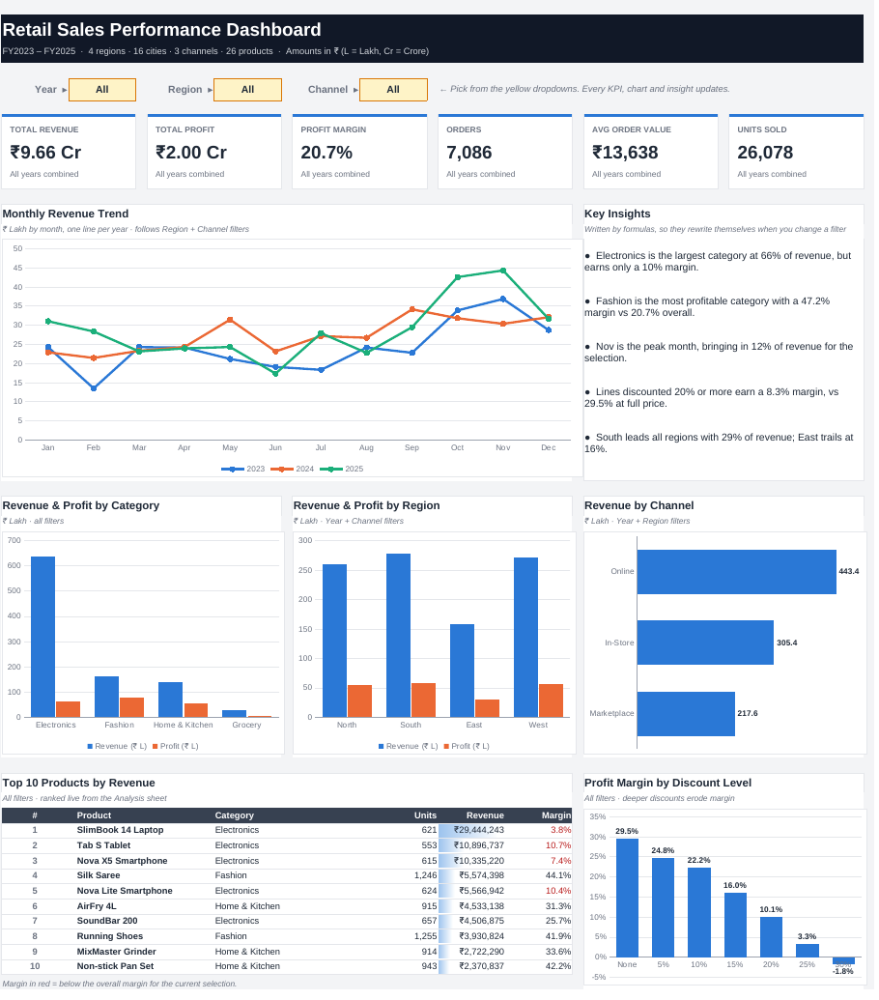
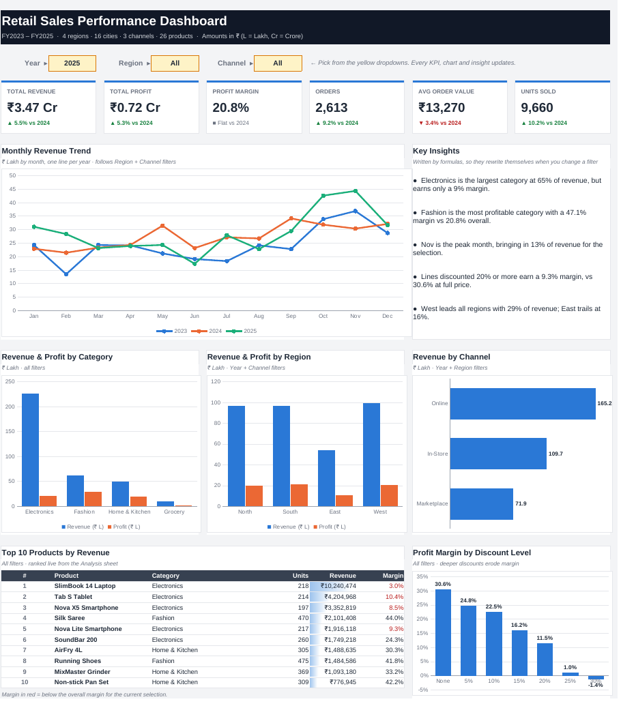

# Retail Sales Performance Dashboard (Excel)

An interactive, one-page Excel dashboard that analyses three years (FY2023–FY2025) of retail sales for a multi-region Indian retailer. Three dropdown filters drive every KPI, chart, ranking and written insight. It is built entirely with native Excel formulas: no macros, no PivotTables, and no hardcoded results.



**[Download the workbook](Retail_Sales_Dashboard.xlsx)** (open in Microsoft Excel 2010 or later)

---

## Business questions

| Theme | Question |
|---|---|
| Growth | How did revenue, profit and order volume change year over year? |
| Mix | Which categories, regions and channels drive revenue, and which drive profit? |
| Seasonality | When does demand peak, and how big is the festive-season lift? |
| Pricing | What do discounts cost in margin? |
| Products | Which products lead on revenue, and are the top sellers also profitable? |

## Key findings

- **Revenue is not profit.** Electronics brings in **66% of revenue** but earns only a **10% margin**. The #1 product by revenue (a laptop) makes just **3.8%**. Fashion is about a sixth of revenue but earns a **47% margin**.
- **Discounting is the biggest margin lever.** Order lines discounted 20% or more earn an **8.3% margin**, against **29.5%** at full price, and 30% discounts lose money. About 71% of lines carry some discount.
- **Strong festive seasonality.** October and November average **1.47×** the revenue of other months and together account for **23% of annual sales**.
- **Growth is slowing, and it is volume-led.** Revenue grew **13.0%** in 2024 and **5.5%** in 2025. In 2025, orders rose 9.2% while average order value *fell* 3.4%, so growth is coming from more customers rather than bigger baskets.
- **Regional gap.** South leads with 29% of revenue; East trails at 16%, which makes it the clearest expansion opportunity.

**Recommendations:** cap discounts at 15% outside the festive window; push high-margin Fashion and Home & Kitchen through cross-sells on electronics orders; review laptop pricing and supplier terms; and test targeted campaigns in the East region.

## Interactivity

Pick a **Year**, **Region** and **Channel** from the yellow dropdowns. Selecting 2024 or 2025 turns on year-over-year comparisons on every KPI card (green ▲ / red ▼).



## What's on the dashboard

- **6 KPI cards:** Revenue, Profit, Profit Margin, Orders, Average Order Value, Units Sold, each with YoY change
- **Monthly revenue trend:** one line per year, so you can compare seasonality across years
- **Revenue and profit by category and by region:** side-by-side bars that show where revenue and margin diverge
- **Revenue by channel:** Online, In-Store and Marketplace
- **Profit margin by discount level:** shows how much margin each discount band costs
- **Top 10 products:** ranked live, with data bars and products below the average margin flagged in red
- **Key insights panel:** five sentences written by formulas that rewrite themselves when filters change

## How it's built

The workbook keeps three layers separate, the way a BI model would:

```
Data sheet  ──►  Analysis sheet  ──►  Dashboard sheet
(raw table)      (all calculations)   (presentation only)
```

| Sheet | Role |
|---|---|
| **Dashboard** | Presentation only. Every cell references the Analysis sheet. |
| **Analysis** | Filter criteria, KPI block with prior-year comparison, and the aggregate tables that feed each chart |
| **Data** | 11,823 order lines (7,086 orders) in an Excel Table |
| **About** | Project summary, usage guide and data dictionary |

### Excel techniques used

- **`SUMIFS` with wildcard criteria.** Choosing "All" in a filter becomes `"*"`, so one formula handles both filtered and unfiltered views.
- **Named ranges** (`dRevenue`, `dRegion`, `fYear`, `fPrior` …) keep formulas readable, for example `=SUMIFS(dRevenue, dYear,fYear, dRegion,fRegion, dChannel,fChannel)`.
- **Distinct order count** using a helper flag column summed with `SUMIFS`.
- **Live Top-N ranking** with `RANK` + `COUNTIF` tie-breaking and `INDEX`/`MATCH` lookups.
- **Dynamic narrative text** built with `INDEX`/`MATCH`, `MAX`/`MIN` and `TEXT()`.
- **Data validation** dropdowns as the dashboard's controls.
- **Conditional formatting:** data bars, ▲/▼ colour cues, and flags for below-average margins.
- **Error handling:** `IFERROR` and zero-denominator guards, so empty selections never show `#DIV/0!`.

## Repository structure

```
├── Retail_Sales_Dashboard.xlsx    # the dashboard
├── data/
│   └── sales_data.csv             # raw dataset (same as the Data sheet)
├── images/                        # screenshots used in this README
└── scripts/
    ├── generate_data.py           # builds the synthetic dataset (seeded, reproducible)
    ├── build_dashboard.py         # builds the workbook with openpyxl
    └── add_cached_values.py       # stores calculated values so previews show numbers
```

## Reproduce it

```bash
pip install -r requirements.txt
python scripts/generate_data.py      # writes data/sales_data.csv
python scripts/build_dashboard.py    # writes Retail_Sales_Dashboard.xlsx
```

Formulas calculate when the file is opened in Excel. `add_cached_values.py` is optional. It copies values from a recalculated copy (for example, one saved by LibreOffice) into the file so that previewers that don't calculate formulas, such as GitHub's file viewer, still show numbers.

## About the data

The dataset is **synthetic**: a seeded Python simulation with realistic seasonality, year-over-year growth, category-specific margins and discount behaviour. It does not represent any real company. Amounts are in Indian Rupees (₹); 1 Lakh = 100,000 and 1 Crore = 10,000,000.

## Tools

Microsoft Excel · Python (pandas, NumPy, openpyxl)
